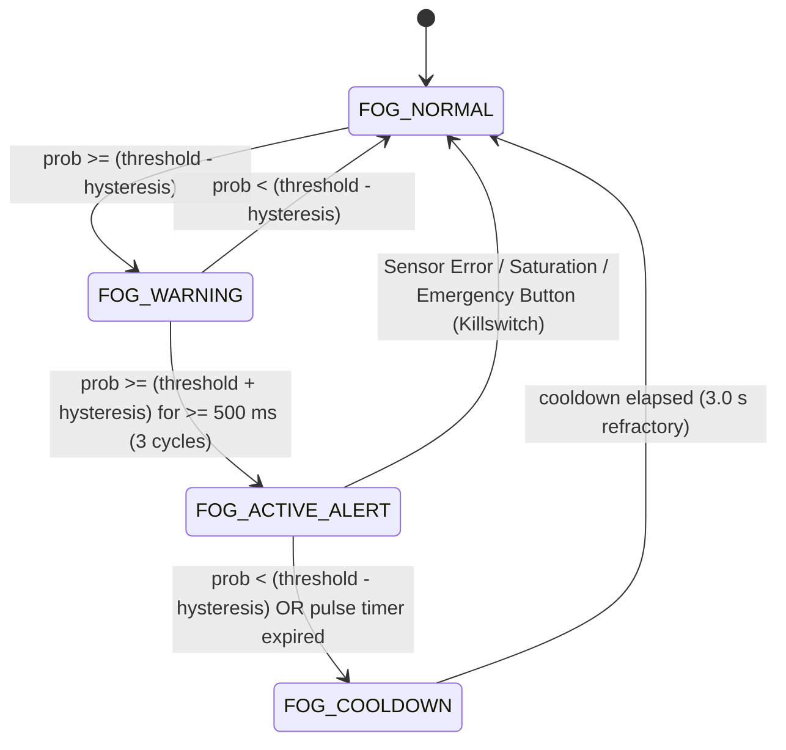

# FoG-Roboforge: Wearable Parkinson's Freezing-of-Gait Prediction & Haptic Cueing System

[](https://www.espressif.com/en/products/socs/esp32)
[-green.svg)](https://invensense.tdk.com/products/motion-tracking/6-axis/mpu-6050/)
[-orange.svg)](https://www.tensorflow.org/lite/microcontrollers)
[-brightgreen.svg)]()
[]()

An end-to-end wearable system for real-time, subject-independent detection of **Freezing of Gait (FoG)** in Parkinson's disease patients, deploying a TinyML 1D Temporal Convolutional Neural Network (CNN) directly onto an **ESP32 microcontroller** to drive **closed-loop rhythmic haptic cueing**.

---

## Table of Contents
1. [Clinical Background & Objectives](#clinical-background--objectives)
2. [System Architecture](#system-architecture)
3. [Hardware Specifications & Wiring](#hardware-specifications--wiring)
4. [Machine Learning Pipeline & Model Architecture](#machine-learning-pipeline--model-architecture)
5. [Clinical Decision Engine & Haptic Cueing](#clinical-decision-engine--haptic-cueing)
6. [ESP32 Firmware Architecture](#esp32-firmware-architecture)
7. [Step-by-Step Firmware Flashing Guide](#step-by-step-firmware-flashing-guide)
8. [Python Research & Training Pipeline](#python-research--training-pipeline)
9. [Repository Structure](#repository-structure)
10. [Documentation & References](#documentation--references)

---

## Clinical Background & Objectives

Freezing of Gait (FoG) is an episodic, highly debilitating symptom of advanced Parkinson's disease where individuals suddenly feel as though their feet are glued to the floor. FoG episodes lead directly to falls, injuries, and loss of independence. 

Clinical research demonstrates that **external rhythmic sensory cueing** (auditory or tactile metronome pulsing) stimulates the premotor cortex and compensatory neural pathways, allowing patients to unfreeze their gait.

### Engineering & System Objectives
* **Subject-Independent Detection:** Models are evaluated with strict patient separation (zero patient overlap between train, validation, and test cohorts).
* **Minimal Wearable Hardware:** Strictly utilizes a **single 3-axis accelerometer on the ankle**; eliminates bulky gyroscopes, EMG, or EEG arrays for wearable comfort and battery life.
* **Causal Real-Time Edge Processing:** Runs 100% locally on an ESP32 microcontroller with zero reliance on cloud or Bluetooth latency.
* **Low Latency & High Headroom:** Inference latency is **~7.5 ms**, well within the 200 ms (5 Hz) sliding window stride.

---

## System Architecture

```
   +-------------------------------------------------------------------------+
   |                            WEARABLE HARDWARE                            |
   |                                                                         |
   |  [InvenSense MPU6050] (I2C 400kHz @ 50 Hz)                              |
   |         │                                                               |
   |         ▼                                                               |
   |  [ESP32 Core 0: High-Priority Sampling Task]                            |
   |     • 50.0 Hz deterministic sampling (vTaskDelayUntil)                  |
   |     • LSB to m/s² conversion & ADC saturation check                     |
   |     • Lock-free circular ring buffer (100 samples)                      |
   |         │                                                               |
   |         ▼ (FreeRTOS Overwrite Mailbox Queue)                            |
   |  [ESP32 Core 1: TinyML Inference & Clinical FSM]                        |
   |     • Z-score normalization & INT8 tensor quantization                  |
   |     • TFLM 1D Temporal CNN forward pass (~7.5 ms)                       |
   |     • Exponential Moving Average (EMA) & Hysteresis FSM                 |
   |     • Consecutive confirmation filter (≥ 500 ms)                        |
   |         │                                                               |
   |         ▼                                                               |
   |  [Closed-Loop Rhythmic Sensory Cueing]                                  |
   |     • GPIO 13: 1 kHz LEDC PWM -> Low-side N-FET -> 1027 Coin ERM Motor |
   |     • 3-pulse cadence metronome (150 ms pulse / 100 ms pause)           |
   +-------------------------------------------------------------------------+
```

---

## Hardware Specifications & Wiring

The hardware architecture uses the **ESP32 DevKit V1 (ESP32-WROOM-32)** and an **InvenSense MPU6050** IMU breakout.

### Pinout & Electrical Interconnects

| Peripheral | Component | ESP32 DevKit V1 Pin | Electrical Configuration |
| :--- | :--- | :--- | :--- |
| **I2C SDA** | InvenSense MPU6050 | **GPIO 21** | I2C Data (4.7 kΩ pull-up to 3.3V) |
| **I2C SCL** | InvenSense MPU6050 | **GPIO 22** | I2C Clock (400 kHz Fast-Mode) |
| **Sensor VCC** | InvenSense MPU6050 | **3.3V** | Regulated 3.3V DC power rail |
| **Sensor GND** | InvenSense MPU6050 | **GND** | System common ground |
| **Sensor AD0** | InvenSense MPU6050 | **GND** | Sets I2C slave address to `0x68` |
| **Haptic Motor**| 1027 Coin ERM Motor | **GPIO 13** | LEDC PWM (Channel 0, 1 kHz carrier, 8-bit duty) |
| **Status LED** | Onboard Blue LED | **GPIO 2** | Digital output (`HIGH` = Active) |
| **Emergency Stop**| BOOT Switch | **GPIO 0** | Digital input (`INPUT_PULLUP`), active LOW |

### MPU6050 Register Initialization
* **`PWR_MGMT_1` (0x6B) = `0x01`**: Wake device, PLL with X-axis gyro reference.
* **`CONFIG` (0x1A) = `0x03`**: Digital Low-Pass Filter (DLPF) set to 44 Hz accelerometer bandwidth.
* **`SMPLRT_DIV` (0x19) = `0x13` (19 dec)**: Sample rate divisor: $F_s = \frac{1000\text{ Hz}}{1 + 19} = 50.0\text{ Hz}$.
* **`ACCEL_CONFIG` (0x1C) = `0x00`**: Accelerometer Full-Scale Range set to $\pm 2\text{ g}$ ($16,384\text{ LSB/g}$).

---

## Machine Learning Pipeline & Model Architecture

### Signal Preprocessing & Windowing
* **Input Window Shape:** `[1, 100, 3]` (100 time samples $\times$ 3 axes $[A_x, A_y, A_z]$).
* **Temporal Coverage:** 100 samples @ 50 Hz = **2.00 seconds** of continuous gait.
* **Stride Rate:** 10 samples @ 50 Hz = **0.20 seconds** (evaluates 5.0 predictions per second).
* **Z-Score Normalization:**
  $$\hat{A}_c(t) = \frac{\operatorname{clip}(A_c(t), -19.6133, 19.6133) - \mu_c}{\sigma_c}$$
  * $\mu = [-4.209929, 6.489753, 1.580877]\text{ m/s}^2$
  * $\sigma = [5.812658, 5.164641, 2.514854]\text{ m/s}^2$

### 1D Temporal CNN Architecture (`combined_cnn_gravity_0.2`)
The model employs 1D temporal convolutions followed by Global Average Pooling, creating a translation-invariant representation across the 2-second gait window with only **1,669 trainable parameters**.

```
Input: [1, 100, 3]
  │
  ├──► Conv1D Block 1:  3 in ➔ 12 out, Kernel=5, Pad=2 (same), ReLU  [192 params]
  │    (Captures step impacts and micro-temporal acceleration transitions)
  │
  ├──► Conv1D Block 2: 12 in ➔ 12 out, Kernel=5, Pad=2 (same), ReLU  [732 params]
  │    (Captures gait rhythm and 3–8 Hz high-frequency freeze band tremor)
  │
  ├──► Conv1D Block 3: 12 in ➔ 12 out, Kernel=5, Pad=2 (same), ReLU  [732 params]
  │    (Extracts high-level temporal context across the 2.0-second horizon)
  │
  ├──► GlobalAveragePooling1D across 100 timesteps                   [  0 params]
  │    (Translation-invariant feature vector of dimension [1, 12])
  │
  └──► Dense Head: 12 in ➔ 1 out, Sigmoid activation                [ 13 params]
       Output: Scaled FoG probability p ∈ [0.0, 1.0]

Total Parameters: 1,669 (Fully INT8 Quantized)
```

### Full Integer INT8 Quantization
* **Model Footprint:** 9,008 bytes (compiled into `model_data.h`).
* **Input Quantization:** Scale $S_{in} = 0.061168$, Zero-Point $Z_{in} = 10$.
* **Output Quantization:** Scale $S_{out} = 0.00390625$ ($1/256$), Zero-Point $Z_{out} = -128$.
* **Tensor Arena RAM:** 48 KB static allocation (consumes only ~14–25 KB during inference).
* **Measured Inference Latency:** **7.5 to 8.5 ms** on ESP32 @ 240 MHz.

---

## Clinical Decision Engine & Haptic Cueing

To prevent false alarms caused by brief stumbles, sensor noise, or boundary transients, the firmware incorporates a 4-state clinical Finite State Machine (FSM):



1. **Exponential Moving Average (EMA) Smoothing:**  
   $$\bar{p}_t = 0.60 \cdot p_t + 0.40 \cdot \bar{p}_{t-1}$$
2. **Dual-Threshold Hysteresis:**  
   * **Activation Threshold ($\theta_{high}$):** $0.65$
   * **Reset Threshold ($\theta_{low}$):** $0.45$
3. **Consecutive Confirmation:**  
   Candidate freeze episodes must remain above $\theta_{high}$ for at least **3 consecutive inference cycles (500 ms)** before triggering haptic actuation.
4. **Cadence Pacing (Sensory Cueing):**  
   Continuous vibration numbs mechanoreceptors; the driver emits a **3-pulse metronome cadence** (150 ms pulse ON, 100 ms pause, duty cycle 220/255 @ 1 kHz) to break the freeze.
5. **Safety Interlocks:**  
   * Hardware watchdog resets the microcontroller if an internal task hangs.
   * Pressing the **BOOT button (GPIO 0)** immediately kills motor PWM.
   * Interactive serial commands (`V` to arm, `v` to disarm).

---

## ESP32 Firmware Architecture

The firmware is located in `_rebuild/firmware/esp32/` and is fully compatible with **ESP32 Arduino Core 2.x and Core 3.x (ESP-IDF 5.x)**:

* **`esp32.ino`:** FreeRTOS dual-core entry point, pin mappings, and task creation.
* **`deployment_config.h`:** Normalization parameters ($\mu, \sigma$) and FSM threshold definitions.
* **`model_data.h`:** Embedded byte array of the INT8 TFLM model flatbuffer.
* **`preprocessing.h`:** C++ standardizer, clamping, and FSM data structures.

### FreeRTOS Dual-Core Allocation
* **Core 0 (Priority 3 - Real-Time Acquisition):**  
  Dedicated 50 Hz timer loop polling MPU6050 over I2C Fast Mode, checking for ADC saturation ($|raw| \ge 32,760$), and pushing valid samples into the sliding window.
* **Core 1 (Priority 1 - TinyML Inference):**  
  Consumes snapshots from the overwrite mailbox queue, quantizes inputs, executes the TFLM interpreter, and manages the FSM state.

---

## Step-by-Step Firmware Flashing Guide

### Method 1: Using Arduino IDE 2.x

1. **Install Arduino IDE 2.x** and install the **ESP32 Board Package**:
   * Add URL in **Preferences**: `https://raw.githubusercontent.com/espressif/arduino-esp32/gh-pages/package_esp32_index.json`
   * In **Boards Manager**, install `esp32` by Espressif Systems.
2. **Open the Project:**
   * Go to **File $\to$ Open...** and select:  
     `_rebuild/firmware/esp32/esp32.ino`
   * *Verify that `model_data.h`, `preprocessing.h`, and `deployment_config.h` appear as tabs.*
3. **Configure Board Settings under `Tools`:**
   * **Board:** `ESP32 Dev Module`
   * **Port:** Your ESP32 COM Port (e.g. `COM3`, `COM4`)
   * **Upload Speed:** `921600` (or `115200` if connection drops)
   * **Partition Scheme:** `Huge APP (3MB No OTA/1MB SPIFFS)`
4. **Compile & Upload:**
   * Click the **Verify** checkmark (`Ctrl + R`), then **Upload** (`Ctrl + U`).
   * *If the console shows `Connecting........_____.....`:* Press and hold the on-board **BOOT (GPIO 0)** button until the upload starts.
5. **View Live Telemetry:**
   * Open **Serial Monitor** at **115200 baud**.
   * Telemetry streams live:
     * `S,<timestamp_ms>,<acc_x>,<acc_y>,<acc_z>,<valid>` (50 lines/second).
     * `P,<timestamp_ms>,<prob>,<alarm_active>,<latency_us>,<error_count>` (5 lines/second).

---

## Python Research & Training Pipeline

The Python pipeline under `src/` provides reproducible model training, causal polyphase resampling, and strict subject-level cross-validation across clinical datasets:

### Datasets
* **UCI Daphnet Freezing of Gait:** 17 recordings across 10 Parkinson's patients (measured 62.5 Hz $\to$ causal resampled to 50 Hz).
* **FoG-STAR (University of Michigan):** Multi-task protocol across 22 Parkinson's participants (60.0 Hz $\to$ causal resampled to 50 Hz).

### Reproduction & Development Commands

```bash
# 1. Create and activate virtual environment
python -m venv .venv
source .venv/bin/activate  # On Windows: .venv\Scripts\activate

# 2. Install dependencies in editable mode
pip install -e ".[dev,train]"

# 3. Run regression and parity test suites
pytest -v

# 4. Run training foundation smoke test
python -m src.training.smoke --root . --steps 5
```

---

## Repository Structure

```
FoG-Roboforge/
├── docs/
│   ├── data_contract.md                    # Data contracts, schemas, units, and manifests
│   ├── training.md                         # Training, validation splits, and metrics guide
│   └── FIRMWARE_IMPLEMENTATION_PLAN_CODEX.md # Technical specification for autonomous firmware builds
├── src/
│   ├── config/settings.yaml                # Global hyperparameters and data configurations
│   ├── data/                               # Loaders, causal resampling, and participant splits
│   ├── features/                           # IMU spectral features, multiscale filters, windowing
│   ├── models/                             # PyTorch CNN and causal dilated TCN architectures
│   ├── training/                           # Trainer, class weighting, and comparison scripts
│   ├── evaluation/                         # Event-level metrics, PR-AUC, and threshold tuning
│   └── inference/                          # Post-processing causal hysteresis and ensemble logic
├── _rebuild/
│   ├── firmware/esp32/                     # Deployed ESP32 C++ firmware (Core 2.x & 3.x compatible)
│   │   ├── esp32.ino                       # Main Arduino/FreeRTOS dual-core firmware
│   │   ├── deployment_config.h             # Normalization constants & threshold settings
│   │   ├── model_data.h                    # 9 KB INT8 TFLM model flatbuffer array
│   │   └── preprocessing.h                 # Fixed-point preprocessing & FSM state definitions
│   ├── artifacts/deployment/               # Exported TFLite models (float & int8), validation JSON
│   └── reports/                            # Comprehensive experimental audits and benchmarks
├── tests/                                  # Pytest unit and regression test suite
├── pyproject.toml                          # Build definitions and package metadata
└── README.md                               # Project documentation
```

---

## Documentation & References

* **[Firmware Implementation Plan for Codex](file:///docs/FIRMWARE_IMPLEMENTATION_PLAN_CODEX.md):** Complete technical engineering specification for autonomous firmware rebuilds.
* **[Data Contract Specification](file:///docs/data_contract.md):** Exact coordinate system standards, units, sampling rules, and label semantics.
* **[Training & Evaluation Guide](file:///docs/training.md):** Participant-level cross-validation protocols and event metrics.
* **[Deployment Validation Report](file:///New-project/data/raw/_rebuild/artifacts/deployment/validation.json):** Numerical parity check logs and INT8 quantization benchmarks.
