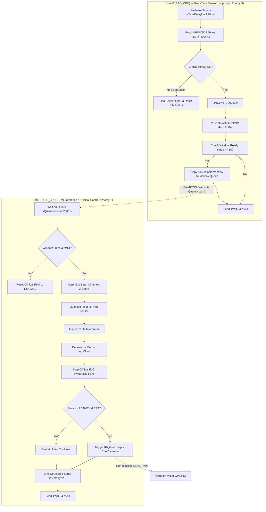
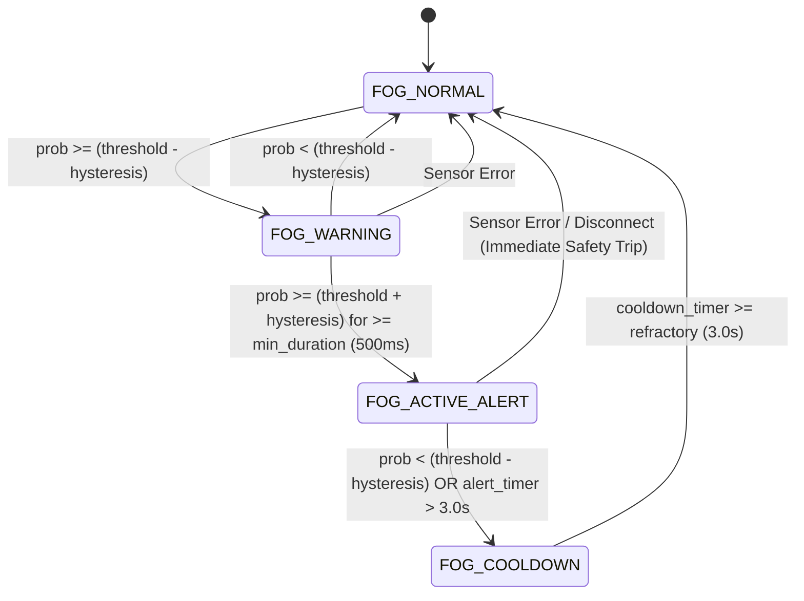
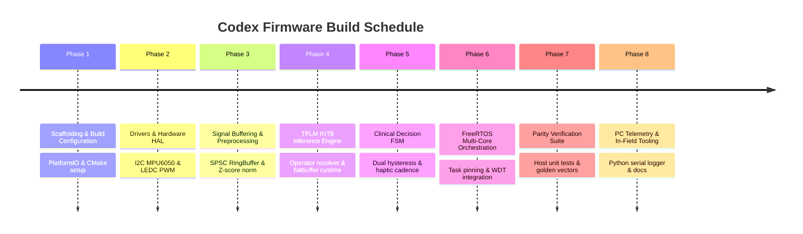

# ESP32 Firmware Implementation Plan for Codex
**Target Platform:** ESP32-WROOM-32 DevKit V1 (Xtensa Dual-Core LX6 @ 240 MHz, 520 KB SRAM)  
**Task Domain:** Real-time Wearable Freezing of Gait (FoG) Detection & Rhythmic Haptic Cueing  
**Author / Orchestration:** Google DeepMind Antigravity  
**Target Executor:** Codex Coding Agent  
**Status:** Approved for Execution  

---

## 1. Executive Summary & Objective

This document serves as the complete, technically rigorous, step-by-step implementation blueprint for **Codex** to engineer, build, verify, and document the production-grade embedded firmware for the Parkinson's Freezing of Gait (FoG) detection device.

### Core Objectives
1. **Zero Hardware Modifications:** Adhere strictly to the physical hardware pinout and sensor configuration.
2. **Deterministic Real-Time Sampling:** Maintain a jitter-free 50.0 Hz ($\pm 0.5\%$) accelerometer sampling loop on ESP32 Core 0 via FreeRTOS hardware timers.
3. **Causal Edge Inference:** Run full-integer INT8 TensorFlow Lite for Microcontrollers (TFLM) inference on Core 1 every 200 ms (10-sample stride, 5.0 Hz decision emission) within a static internal RAM footprint ($< 70\text{ KB}$ tensor arena).
4. **Clinical Alarm FSM & Sensory Cueing:** Execute a non-blocking 4-state causal hysteresis Finite State Machine (FSM) driving an ERM vibration motor via ESP32 LEDC PWM with rhythmic metronome pulses.
5. **Strict Python-to-Firmware Parity:** Guarantee bit-exact or $\varepsilon$-bounded numerical parity ($|\Delta p| \le 0.05$) between offline Python feature pipelines and on-chip C++ fixed-point inference.
6. **Robust Safety & Telemetry:** Implement Task Watchdog Timers (TWDT), sensor saturation/disconnect fault isolation, fail-safe motor killswitches, and a structured serial logging protocol.

---

## 2. Hardware Architecture & Frozen Constraints

The hardware design is physically locked and must not be altered:

```
                  +----------------------------------------------+
                  |         ESP32-WROOM-32 DevKit V1             |
                  |                                              |
 [3.3V / GND] ----+-- 3V3 / GND                                  |
                  |                                              |
 [InvenSense  ] --+-- GPIO 21 (I2C SDA)                          |
 [MPU6050 IMU ] --+-- GPIO 22 (I2C SCL)                          |
                  |                                              |
 [ERM Motor   ] <-+-- GPIO 13 (LEDC Channel 0, 1 kHz PWM)        |
 [Low-Side FET]   |                                              |
                  |                                              |
 [Onboard LED ] <-+-- GPIO 2 (Status / Heartbeat / Fault)        |
 [BOOT Button ] --+-- GPIO 0 (Active LOW, Emergency Killswitch)  |
                  +----------------------------------------------+
```

### 2.1 Pin Assignment Matrix
| Peripheral | Component | ESP32 Pin | Interface / Configuration | Electrical Characteristics |
| :--- | :--- | :--- | :--- | :--- |
| **IMU SDA** | InvenSense MPU6050 | **GPIO 21** | I2C Data (Master mode) | External $4.7\text{ k}\Omega$ pullup to 3.3V |
| **IMU SCL** | InvenSense MPU6050 | **GPIO 22** | I2C Clock (400 kHz Fast Mode) | External $4.7\text{ k}\Omega$ pullup to 3.3V |
| **Haptic Motor**| 1027 Coin ERM Motor | **GPIO 13** | LEDC PWM (Channel 0, Timer 0) | Low-side N-FET (3.0V, 80mA, flyback diode) |
| **Status LED** | Onboard Blue LED | **GPIO 2** | Digital Output (`HIGH` = Active) | Current limiting resistor to ground |
| **BOOT Switch**| Onboard Pushbutton | **GPIO 0** | Digital Input (`INPUT_PULLUP`) | Active LOW debounce circuit |

### 2.2 MPU6050 Register Configuration
The IMU must be configured at boot via I2C register writes:
* **`PWR_MGMT_1` (0x6B) = `0x01`**: Wake device from sleep, select PLL with X-axis gyroscope clock reference.
* **`CONFIG` (0x1A) = `0x03`**: Digital Low-Pass Filter (DLPF) set to 44 Hz accelerometer bandwidth (delay $4.8\text{ ms}$).
* **`SMPLRT_DIV` (0x19) = `0x13` (19 dec)**: Sample rate divisor: $F_s = \frac{1000\text{ Hz}}{1 + 19} = 50.0\text{ Hz}$.
* **`ACCEL_CONFIG` (0x1C) = `0x00`**: Full-scale acceleration range $\pm 2\text{ g}$ (sensitivity $16,384\text{ LSB/g}$).
* **`GYRO_CONFIG` (0x1B) = `0x08`**: Full-scale $\pm 500^\circ/\text{s}$ (channel read discarded; not fed into inference).

> [!IMPORTANT]
> **Strict Sensor Restriction:** Only 3-axis accelerometer signals ($[A_x, A_y, A_z]$ in units of $\text{m/s}^2$ or normalized $\text{g}$) are valid model inputs. Gyroscope, magnetometer, or temperature data must never enter the feature or inference pipelines.

---

## 3. Directory Layout & Repository Structure

Codex must generate code adhering to this unified layout under `firmware/`:

```
firmware/
├── CMakeLists.txt                      # Top-level ESP-IDF / PlatformIO build spec
├── platformio.ini                      # PlatformIO environment (Arduino ESP32 2.0.14)
├── include/
│   ├── deployment_config.h             # Normalization constants, thresholds, quantization params
│   ├── fog_fsm.h                       # Clinical 4-state hysteresis detection engine
│   ├── haptic_driver.h                 # Non-blocking LEDC PWM rhythmic cueing driver
│   ├── imu_driver.h                    # Non-blocking MPU6050 I2C acquisition driver
│   ├── model_data.h                    # C byte array containing INT8 TFLite flatbuffer
│   ├── ring_buffer.h                   # Lock-free single-producer single-consumer ring buffer
│   ├── tflm_engine.h                   # TensorFlow Lite for Microcontrollers inference engine
│   └── telemetry.h                     # High-speed serial protocol & error reporting
├── src/
│   ├── fog_fsm.cpp
│   ├── haptic_driver.cpp
│   ├── imu_driver.cpp
│   ├── main.cpp                        # System setup, FreeRTOS dual-core tasks, panic hooks
│   ├── ring_buffer.cpp
│   ├── tflm_engine.cpp
│   └── telemetry.cpp
├── tests/
│   ├── CMakeLists.txt                  # Host-native C++ build (Catch2 / GoogleTest)
│   ├── host_parity_test.cpp            # Host C++ parity test against Python vectors
│   ├── test_ring_buffer.cpp            # Ring buffer boundary & concurrency unit tests
│   └── test_fsm.cpp                    # Hysteresis and refractory state machine tests
└── tools/
    ├── generate_model_header.py        # Python script converting .tflite to model_data.h
    ├── export_test_vectors.py          # Python script dumping golden test tensors to JSON/C
    └── serial_logger.py                # Host PC Python tool for streaming & live visualization
```

---

## 4. Software Architecture & FreeRTOS Dual-Core Design

The ESP32 possesses two independent 32-bit Xtensa LX6 CPU cores (`PRO_CPU` Core 0 and `APP_CPU` Core 1). The firmware isolates real-time I/O from computation:



### 4.1 Task Specifications

#### Task 1: `task_sensor_acquisition` (Pinned to Core 0)
* **Priority:** 3 (High, above Wi-Fi / Idle).
* **Periodicity:** Exact 20.0 ms (50 Hz) enforced via `vTaskDelayUntil(&xLastWakeTime, pdMS_TO_TICKS(20))`.
* **Stack Size:** 4,096 bytes statically allocated.
* **Responsibilities:**
  1. Poll MPU6050 registers `0x3B` through `0x40` via I2C DMA or Fast-Mode I2C ($400\text{ kHz}$).
  2. Verify transaction latency ($< 3.5\text{ ms}$). If I2C times out ($> 10\text{ ms}$), trigger hardware bus recovery (clock toggling).
  3. Validate sample integrity: check for ADC saturation ($|raw| \ge 32760$). Saturated readings invalidate the entire current window.
  4. Write $[x, y, z]$ float values into `RingBuffer`.
  5. Increment stride counter. When `stride >= 10` (every 200 ms) and `buffer.count >= 100`, construct a snapshot `SensorWindow` struct and send to `xQueueOverwrite(g_window_queue, &window)`.
  6. Emit live serial data (`S,timestamp,ax,ay,az,valid`) if serial transmission buffer has sufficient space.

#### Task 2: `task_inference_and_control` (Pinned to Core 1)
* **Priority:** 1 (Normal background compute).
* **Periodicity:** Event-driven, blocks on `xQueueReceive(g_window_queue, &window, pdMS_TO_TICKS(250))`.
* **Stack Size:** 8,192 bytes statically allocated.
* **Responsibilities:**
  1. Verify window staleness: if `millis() - window.timestamp > 150` or sequence generation has jumped, discard window.
  2. Z-score normalize: $z_c = \frac{\text{clip}(x_c, -19.6133, 19.6133) - \mu_c}{\sigma_c}$.
  3. INT8 Quantization: $q_i = \text{clip}\left(\left\lfloor \frac{z_i}{S_{in}} + 0.5 \right\rfloor + Z_{in}, -128, 127\right)$.
  4. Invoke `MicroInterpreter::Invoke()`. Benchmark execution latency with `esp_timer_get_time()`.
  5. Dequantize output probability: $p = (q_{out} - Z_{out}) \times S_{out}$.
  6. Feed probability $p$ into `FoGDetectionFSM::update(p)`.
  7. If FSM triggers alert, command `HapticDriver::triggerCadenceCue()`.
  8. Output serial prediction packet: `P,timestamp,prob,state,latency_us,err_count`.

---

## 5. Mathematical Specification of Preprocessing & Quantization

To guarantee zero discrepancy between Python training and C++ embedded runtime, Codex must follow these exact equations.

### 5.1 Causal Normalization (Z-Score Standardization)
Each channel $c \in \{0, 1, 2\}$ corresponding to $[A_x, A_y, A_z]$ is standardized using constants frozen from training:

$$\hat{x}_c(t) = \frac{\text{clamp}\left(x_c(t), -19.6133, 19.6133\right) - \mu_c}{\sigma_c}$$

Constants from deployment calibration (`deployment_config.h`):
```c
static const float FOG_MEAN[3] = {-4.209928513e+00f, 6.489753246e+00f, 1.580876827e+00f};
static const float FOG_STD[3]  = { 5.812657833e+00f, 5.164641380e+00f, 2.514853954e+00f};
```

### 5.2 Quantization to INT8 Tensor
The normalized floating-point tensor of dimension $[1, 100, 3]$ maps into signed 8-bit integers:

$$q_i = \text{clamp}\left( \operatorname{round}\left( \frac{\hat{x}_i}{S_{in}} \right) + Z_{in}, -128, 127 \right)$$

Where from `validation.json`:
* $S_{in} = 0.06116848438978195$
* $Z_{in} = 10$

### 5.3 Output Dequantization
The model produces a single INT8 output logit or probability $q_{out}$:

$$p = (q_{out} - Z_{out}) \times S_{out}$$

Where from `validation.json`:
* $S_{out} = 0.00390625$ ($\frac{1}{256}$)
* $Z_{out} = -128$

---

## 6. Clinical State Machine & Rhythmic Haptic Cueing



### 6.1 State Definitions
1. **`FOG_STATE_NORMAL` (0):** Baseline walking or rest. Motor is OFF. LED is steady green or slow heartbeat ($1\text{ Hz}$).
2. **`FOG_STATE_WARNING` (1):** High probability observed, but not yet sustained. Candidate freeze event under evaluation. Motor is OFF.
3. **`FOG_STATE_ACTIVE_ALERT` (2):** Sustained Freeze of Gait confirmed ($p \ge \theta_{high}$ for $\ge 500\text{ ms}$). Rhythmic haptic cueing active. Motor pulses on GPIO 13.
4. **`FOG_STATE_COOLDOWN` (3):** Freeze broken or timed out. System enters refractory period ($3.0\text{ s}$) where alarms are suppressed to avoid habituation and actuator overheating.

### 6.2 Haptic Driver & Sensory Cueing Parameters
* **Actuation Principle:** Sensory cueing utilizes auditory-tactile cadence pacing to bypass basal ganglia motor blocks. Continuous vibration induces sensory adaptation and numbness; **rhythmic pulsing** is clinically mandatory.
* **Carrier Frequency:** $1,000\text{ Hz}$ PWM via ESP32 LEDC Channel 0.
* **Duty Cycle:** $220 / 255$ ($\approx 86\%$ maximum power for rapid rotor acceleration).
* **Cadence Pattern:**
  * Number of pulses: 3 pulses per cue event.
  * Pulse ON duration: $150\text{ ms}$.
  * Inter-pulse pause: $100\text{ ms}$.
  * Total cue burst duration: $150 + 100 + 150 + 100 + 150 = 650\text{ ms}$.
* **Hardware Interlock:**
  * Motor duty cycle is hardware-capped by software timer: continuous active vibration cannot exceed $2,000\text{ ms}$ under any condition.
  * Manual BOOT button press (GPIO 0 `LOW`) immediately disarms motor and clears all alarms.

---

## 7. Memory Budget & Execution Constraints

```
ESP32 SRAM Partitioning:
+-----------------------------------------------------------+
| Total Physical SRAM: 520 KB                               |
+-----------------------------------------------------------+
| Reserved for Bootloader, ROM, FreeRTOS Kernel: ~180 KB    |
+-----------------------------------------------------------+
| Available Internal User SRAM: ~340 KB                     |
|                                                           |
| [TFLM Tensor Arena]           32.0 KB  (alignas 16)       |
| [Core 0 Task Stack]            4.0 KB                     |
| [Core 1 Task Stack]            8.0 KB                     |
| [Sensor Ring Buffer]           1.2 KB  (100x3 floats)     |
| [FreeRTOS Mailbox Queue]       1.3 KB                     |
| [C++ Runtime & Statics]       12.0 KB                     |
|-----------------------------------------------------------|
| Free Remaining SRAM Margin:  ~281.5 KB (> 82% Headroom)   |
+-----------------------------------------------------------+
```

### Real-Time Latency Budgets
* **I2C Read (6 bytes):** $< 1.2\text{ ms}$ @ $400\text{ kHz}$.
* **Normalization & Quantize (300 floats):** $< 0.15\text{ ms}$.
* **INT8 TFLM Forward Pass:** $< 12.0\text{ ms}$ @ $240\text{ MHz}$ Xtensa LX6.
* **Decision FSM Step:** $< 0.02\text{ ms}$.
* **Total End-to-End Processing Latency:** $< 15.0\text{ ms}$ (comfortably within the $200\text{ ms}$ inference window stride).

---

## 8. Telemetry & Serial Communication Protocol

Baud Rate: **115,200 baud**, 8-N-1. All messages are newline-terminated ASCII.

### 8.1 Stream Packet Types
1. **Sensor Raw Stream (`S`):**
   ```
   S,<timestamp_ms>,<acc_x_mps2>,<acc_y_mps2>,<acc_z_mps2>,<sensor_valid>
   ```
   *Example:* `S,10240,-4.182103,6.512091,1.520112,1`

2. **Prediction & Clinical Decision (`P`):**
   ```
   P,<timestamp_ms>,<raw_prob>,<fsm_state>,<latency_us>,<error_count>
   ```
   *Example:* `P,10400,0.781250,2,8420,0`

3. **Error / System Event (`E`):**
   ```
   E,<timestamp_ms>,<error_code>,<description>
   ```
   *Example:* `E,12050,ERR_I2C_TIMEOUT,Bus recovery initiated`

4. **Heartbeat / Health (`H`):**
   ```
   H,<timestamp_ms>,<heap_free>,<min_heap>,<core0_highwater>,<core1_highwater>
   ```
   *Example:* `H,15000,288216,281400,1820,3240`

---

## 9. Parity Verification & Testing Protocol

Before flashing to physical hardware, Codex must generate and verify host-side parity tests.

```mermaid
flowchart LR
    A[Recorded Raw Accelerometer Batch .npz] --> B[Python Reference Pipeline]
    A --> C[C++ Embedded Preprocessing Header]
    B --> D[Python Normalized Floats & Probs]
    C --> E[C++ Normalized Floats & Probs]
    D --> F{Diff Check: |Py - C++| < 1e-4}
    E --> F
    F -- Pass --> G[Generate Golden Test Vectors Header]
    F -- Fail --> H[Bug in C++ Arithmetic or Clamping]
```

### 9.1 Verification Suites
1. **Host Catch2/Native Unit Tests (`firmware/tests/`):**
   - Test `ring_buffer.h` for wrap-around, overflow protection, and FIFO ordering.
   - Test `fog_fsm.h` with simulated probability time series: verify that transient spikes ($< 500\text{ ms}$) never trigger `ACTIVE_ALERT`, and sustained freezes strictly fire cadence cues.
   - Test `preprocessing.h` normalization against known floating-point vectors.
2. **On-Device Self-Test (`main.cpp`):**
   - At power-on, load 5 hardcoded 100-sample windows from `golden_vectors.h`.
   - Run interpreter inference on Core 1 before starting sensor acquisition.
   - Compare outputs against pre-computed golden logits. If discrepancy exceeds tolerance, flash red LED at $5\text{ Hz}$ and refuse to arm motor.

---

## 10. Step-by-Step Implementation Roadmap for Codex

Codex should execute this plan in eight consecutive phases. Each phase specifies exact deliverables and acceptance criteria.



### Phase 1: Project Scaffolding & Build Configuration
* **Prompt for Codex:**
  > "Create the PlatformIO and CMake build infrastructure for the ESP32 firmware under `firmware/`. Configure the environment for ESP32-WROOM-32 using Arduino ESP32 core 2.0.14. Include dependencies for TensorFlowLite_ESP32 or embed TensorFlow Lite Micro 2.x headers. Set compiler optimization to `-O3` and ensure C++14 support."
* **Deliverables:** `firmware/platformio.ini`, `firmware/CMakeLists.txt`, `firmware/include/deployment_config.h`.
* **Acceptance Criteria:** `pio run` cleanly sets up build environment without library resolution errors.

### Phase 2: Sensor Driver & Hardware HAL
* **Prompt for Codex:**
  > "Implement `firmware/include/imu_driver.h` and `firmware/src/imu_driver.cpp` for the MPU6050 accelerometer. Implement `init()` to configure 400kHz I2C on SDA 21, SCL 22, 50Hz DLPF, and +/-2g range. Implement `readAccel(float* xyz)` returning acceleration in m/s^2, returning false on I2C timeout or sensor ADC saturation. Implement `firmware/include/haptic_driver.h` and `.cpp` for LEDC PWM on GPIO 13 with non-blocking cadence pulsing."
* **Deliverables:** `imu_driver.h`, `imu_driver.cpp`, `haptic_driver.h`, `haptic_driver.cpp`.
* **Acceptance Criteria:** Zero blocking `delay()` calls; non-blocking timer updates in `update()`.

### Phase 3: Lock-Free Ring Buffer & Signal Normalization
* **Prompt for Codex:**
  > "Implement `firmware/include/ring_buffer.h` and `firmware/include/preprocessing.h`. Create a single-producer single-consumer circular buffer holding up to 100 samples of 3-axis acceleration. Implement sliding window extraction with stride 10. Implement Z-score standardization matching offline parameters."
* **Deliverables:** `ring_buffer.h`, `preprocessing.h`, `test_ring_buffer.cpp`.
* **Acceptance Criteria:** Unit tests pass with zero memory corruption on buffer wrap-around.

### Phase 4: TFLM INT8 Inference Engine
* **Prompt for Codex:**
  > "Implement `firmware/include/tflm_engine.h` and `firmware/src/tflm_engine.cpp`. Integrate TensorFlow Lite Micro with `MicroMutableOpResolver` registering only the required ops: Conv2D, ExpandDims, FullyConnected, Logistic, Mean, Pad, Reshape, and Relu. Allocate a static 32KB 16-byte aligned tensor arena. Provide methods to copy normalized windows into the INT8 input tensor and dequantize the output probability."
* **Deliverables:** `tflm_engine.h`, `tflm_engine.cpp`, `model_data.h`.
* **Acceptance Criteria:** Model flatbuffer loads successfully; tensor arena allocation succeeds with $< 35\text{ KB}$ consumption.

### Phase 5: Clinical Decision FSM & Safety Interlocks
* **Prompt for Codex:**
  > "Implement `firmware/include/fog_fsm.h` and `firmware/src/fog_fsm.cpp`. Implement the 4-state clinical state machine: NORMAL, WARNING, ACTIVE_ALERT, and COOLDOWN. Use dual-threshold hysteresis (threshold +/- 0.1), 500ms sustained onset confirmation, and 3000ms refractory cooldown. Ensure that any sensor error immediately resets the FSM to NORMAL and commands motor stop."
* **Deliverables:** `fog_fsm.h`, `fog_fsm.cpp`, `test_fsm.cpp`.
* **Acceptance Criteria:** Unit tests prove transient spikes do not trigger alarms; cooldown periods are strictly enforced.

### Phase 6: FreeRTOS Dual-Core Orchestration & Main Application
* **Prompt for Codex:**
  > "Implement `firmware/src/main.cpp`. Initialize hardware, peripherals, and TFLM engine in `setup()`. Create `taskSensorAcquisition` pinned to Core 0 (priority 3, 20ms period via vTaskDelayUntil) and `taskInferenceAndControl` pinned to Core 1 (priority 1). Connect tasks via an overwrite mailbox queue. Configure the Task Watchdog Timer (TWDT) with 3-second timeout on both tasks. Handle BOOT button (GPIO 0) as an instant emergency haptic stop."
* **Deliverables:** `main.cpp`, `telemetry.h`, `telemetry.cpp`.
* **Acceptance Criteria:** Both tasks run simultaneously; Core 0 sensor sampling maintains 50 Hz with $< 0.5\text{ ms}$ jitter during Core 1 inference.

### Phase 7: Training-to-Firmware Parity Verification
* **Prompt for Codex:**
  > "Implement `firmware/tests/host_parity_test.cpp` and `firmware/tools/export_test_vectors.py`. Export 50 representative 100-sample windows from Python (including walking, turning, freeze episodes, and saturation) with their intermediate normalized values and expected TFLM INT8 predictions. Verify that C++ preprocessing and quantized inference match Python predictions within |Delta p| <= 0.05."
* **Deliverables:** `export_test_vectors.py`, `host_parity_test.cpp`, automated test script.
* **Acceptance Criteria:** 100% of test vectors pass parity thresholds.

### Phase 8: Data Collection Tool & Serial Telemetry
* **Prompt for Codex:**
  > "Implement `firmware/tools/serial_logger.py`. Create a Python CLI tool using `pyserial` that connects to the ESP32, parses 'S,...' raw sensor records and 'P,...' prediction records, logs them to timestamped CSV files, computes live sampling jitter and inference latency, and displays real-time ASCII bar graphs of FoG probability and motor status."
* **Deliverables:** `serial_logger.py`, `docs/FIRMWARE_USER_GUIDE.md`.
* **Acceptance Criteria:** Logs 10 minutes of continuous data at 50 Hz without dropping serial packets.

---

## 11. Acceptance Criteria Checklist for Final Sign-Off

Codex will consider the firmware implementation complete when all items below pass verification:

- [ ] **Compilation:** `platformio run` compiles cleanly with zero warnings (`-Wall -Werror`).
- [ ] **Flash & RAM Footprint:** Firmware binary occupies $< 1.2\text{ MB}$ Flash and $< 70\text{ KB}$ Internal RAM.
- [ ] **Sampling Stability:** Core 0 sampling runs at $50.0\text{ Hz} \pm 0.2\text{ Hz}$ measured over $> 10,000$ consecutive samples.
- [ ] **Inference Latency:** Core 1 forward pass completes in $< 20\text{ ms}$ (leaving $> 180\text{ ms}$ idle time per 200 ms stride).
- [ ] **Numerical Parity:** Maximum absolute difference between C++ TFLM probability and Python reference across 50 golden test windows is $|\Delta p| \le 0.05$.
- [ ] **Actuator Safety:** Motor pin (GPIO 13) drops to `0%` duty cycle immediately upon sensor timeout, manual button press, or when FSM exits `ACTIVE_ALERT`.
- [ ] **Watchdog Test:** Simulated loop lock in either task triggers TWDT reset within $3.0\text{ s}$ without hanging or leaving motor energized.
- [ ] **Telemetry Compliance:** Serial output streams valid `S,...` and `P,...` packets without buffer overflows at 115,200 baud.
